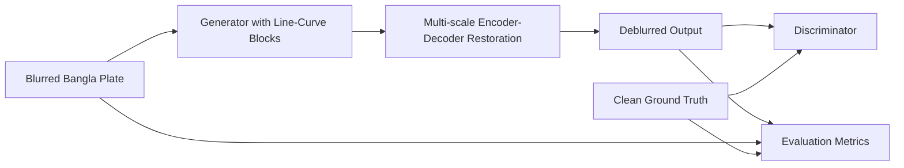

# Line-Curve Block DeblurGAN

A research-focused image restoration project for recovering motion-blurred and distorted Bangla vehicle license plate images using a modified DeblurGAN-v2 generator with a custom Line-Curve block.

The implementation is centered on preserving Bangla character geometry, including horizontal matras, vertical strokes, curves, and structural details that are often lost under motion or Gaussian blur. This repository documents the model architecture, dataset preparation, training setup, and experimental evaluation performed in the local project workspace.

## Table of Contents

- [Project Overview](#project-overview)
- [Key Features](#key-features)
- [Research Motivation](#research-motivation)
- [Proposed Methodology](#proposed-methodology)
- [Line-Curve Block Architecture](#line-curve-block-architecture)
- [Model Architecture and Technical Details](#model-architecture-and-technical-details)
- [Dataset and Preprocessing](#dataset-and-preprocessing)
- [Training](#training)
- [Inference and Usage](#inference-and-usage)
- [Experimental Results](#experimental-results)
- [Model Comparison](#model-comparison)
- [Visual Results](#visual-results)
- [Repository Structure](#repository-structure)
- [Installation and Requirements](#installation-and-requirements)
- [Limitations and Future Work](#limitations-and-future-work)
- [Research Context and References](#research-context-and-references)
- [Author and Acknowledgments](#author-and-acknowledgments)

## Project Overview

This project addresses a practical and challenging computer vision problem: restoring severely blurred Bangla vehicle license plate images so that the textual content remains readable and structurally faithful. The design is not a generic deblurring pipeline; it is tailored to preserve the unique visual shape of Bangla characters, which are especially sensitive to blur because they contain thin strokes, slanted curves, and dense combinations of connected glyph structures.

The repository contains a modified DeblurGAN-v2-style generator trained on paired blurred-clean license plate images. The main architectural contribution is a custom `LineCurveBlock` that explicitly models horizontal structure, vertical structure, and curve-like deformation using a combination of directional convolutions and deformable convolution. The block is inserted throughout the network to improve the restoration of fine character detail while keeping the computational structure close to a convolutional generator baseline.

The implementation is primarily notebook-based and is stored in the project root as `Line-Curve Block DelburGAN.ipynb`, which defines the dataset pipeline, generator/discriminator, loss functions, training loop, and evaluation logic.

## Key Features

- Modified DeblurGAN-v2-style generator for license plate image restoration.
- Custom `LineCurveBlock` with three parallel processing branches:
  - horizontal strip convolution
  - vertical strip convolution
  - deformable curve-aware convolution
- Residual-style fusion that combines directional features and learns a gated feature response.
- Edge-aware restoration objective based on Sobel gradient difference.
- Perceptual feature loss using a pre-trained VGG19 backbone.
- GAN-based adversarial objective for realistic restoration.
- Dataset split into training, validation, and test sets using a folder-based paired image setup.
- Evaluation metrics for PSNR, SSIM, and MAE computed on blurred and restored outputs.
- Local checkpointing for best and latest model states.
- Comparison with baseline restoration models saved in the project output folders.

## Research Motivation

Bangla license plates are difficult to restore because the characters are visually complex, densely arranged, and highly sensitive to blur. Horizontal matras, vertical components, and curved strokes are often merged or lost when motion blur or Gaussian blur degrades the image. Standard generic restoration networks can recover global contrast but may fail to preserve fine character geometry, which is critical for plate readability and downstream OCR.

This project focuses on a structural restoration objective: the model should not merely smooth the image, but should maintain the topology of Bangla characters. The custom `LineCurveBlock` is designed around that idea by explicitly separating feature extraction into directional and deformable subpaths, making the network more responsive to long repeated strokes and curved regions.

## Proposed Methodology

The workflow implemented in the project follows a paired-image supervised restoration pipeline:

1. Clean license plate images are paired with blurred versions generated from Gaussian and motion blur sources.
2. The blurred image is processed by the generator.
3. The generator uses downsampling and multi-scale residual feature extraction with `LineCurveBlock` modules.
4. A discriminator evaluates realism and adversarial consistency.
5. The network is trained using a combined objective involving L1 reconstruction, edge preservation, perceptual similarity, and adversarial loss.
6. The model is evaluated on validation/test images using PSNR, SSIM, and MAE.



## Line-Curve Block Architecture

The central contribution of the project is the custom `LineCurveBlock`, implemented in the main notebook. The block is designed to capture the two dominant structural directions in Bangla characters: horizontal strokes and vertical strokes, while also learning curvilinear patterns through a deformable path.

The actual implementation from the notebook shows the following structure:

```python
class LineCurveBlock(nn.Module):
    def __init__(self, ch):
        super().__init__()
        self.horizontal = nn.Conv2d(ch, ch, (1, 7), padding=(0, 3))
        self.vertical = nn.Conv2d(ch, ch, (7, 1), padding=(3, 0))

        self.offset = nn.Conv2d(ch, 18, 3, padding=1)
        nn.init.zeros_(self.offset.weight)
        nn.init.zeros_(self.offset.bias)
        self.curve = DeformConv2d(ch, ch, 3, padding=1)

        self.fuse = nn.Sequential(
            nn.Conv2d(ch * 3, ch, 1),
            nn.InstanceNorm2d(ch),
            nn.ReLU(True),
        )
        self.gate = nn.Sequential(
            nn.AdaptiveAvgPool2d(1),
            nn.Conv2d(ch, ch // 4, 1),
            nn.ReLU(True),
            nn.Conv2d(ch // 4, ch, 1),
            nn.Sigmoid(),
        )

    def forward(self, x):
        h = self.horizontal(x)
        v = self.vertical(x)
        c = self.curve(x, self.offset(x))
        y = self.fuse(torch.cat([h, v, c], dim=1))
        y = y * self.gate(y)
        return x + y
```

Important details from the code:

- `horizontal` uses a 1x7 convolution to emphasize horizontal strokes and matras.
- `vertical` uses a 7x1 convolution to highlight vertical structures.
- `offset` generates deformation parameters for a deformable convolution, which allows the network to adapt to curved character geometry.
- `curve` is a deformable convolution branch that handles curved edges and irregular letter contours.
- The outputs are concatenated and fused with a 1x1 convolution, then weighted by a learned gate.
- The block adds the input back via a residual connection, preserving the original feature pathway while adding directional refinement.

This design is consistent with the project goal of preserving Bangla characters with long horizontal strokes, vertical pillars, and curved contours.

## Model Architecture and Technical Details

The project is implemented as a generator-discriminator pair. The generator is a multi-scale U-Net-like encoder-decoder with repeated `LineCurveBlock` modules and skip connections.

Key verified architecture details from the notebook:

- Input image shape: `3 x 128 x 256` (RGB, height 128, width 256)
- Batch size: `8`
- Epochs: `20`
- Learning rate: `1e-4`
- Optimizer: Adam with `betas=(0.5, 0.999)`
- Generator channels: `3 -> 64 -> 128 -> 256` with a 4-block bottleneck of `LineCurveBlock(256)`
- Discriminator: a multi-stage convolutional classifier with `64, 128, 256, 512` channels and a final 1-channel output
- Residual skip connections are used between encoder and decoder stages
- Final output is clamped to `[-1, 1]` and added to the input image as a residual restoration term

The generator architecture in simplified form is:

```text
Input (3, 128, 256)
  -> head (7x7 conv)
  -> enc1: LineCurveBlock(64) x2
  -> down1: ConvBlock(64, 128, stride=2)
  -> enc2: LineCurveBlock(128) x2
  -> down2: ConvBlock(128, 256, stride=2)
  -> mid: LineCurveBlock(256) x4
  -> up2 / dec2
  -> up1 / dec1
  -> output conv (3 channels)
  -> residual output + input
```

The discriminator implements a standard adversarial map-based classifier, with each block defined by a `Conv2d` and optional `InstanceNorm2d` + LeakyReLU. The notebook uses a least-squares-style MSE adversarial objective:

```python
d_real = D(clean)
d_fake = D(fake.detach())
d_loss = 0.5 * (
    F.mse_loss(d_real, torch.ones_like(d_real))
    + F.mse_loss(d_fake, torch.zeros_like(d_fake))
)
```

The generator loss is a weighted combination of:

- `L1` reconstruction loss
- edge loss based on Sobel gradients
- VGG-based perceptual loss
- adversarial loss

The exact weights used in the notebook are:

- `W_L1 = 1.0`
- `W_EDGE = 1.0`
- `W_PERC = 0.1`
- `W_ADV = 0.01`

This is a reasonable multi-objective setup for image restoration, where structural fidelity and perceptual realism both matter.

## Dataset and Preprocessing

The notebook uses a paired-image dataset with one clean plate image and two degraded variants:

- `GAUSSIAN_DIR = r"D:\_deblur gan\new dataset\light_gaussian_blurred"`
- `MOTION_DIR = r"D:\_deblur gan\new dataset\light_motion_blurred"`
- `CLEAN_DIR = r"D:\_deblur gan\new dataset\fixed cropped"`

The code builds paired entries by matching filenames across folders and resizing each image to `IMG_W = 256` and `IMG_H = 128` using `Image.BICUBIC` interpolation.

The dataset was custom-made for this project, and its labels were manually annotated. The repository does not document the annotation schema or annotation protocol in enough detail to describe those labels more specifically.

The dataset loader does the following:

- loads each image in RGB format
- resizes it to the target dimensions
- converts pixel values from `[0,255]` to `[-1,1]` using `tensor.float() / 127.5 - 1`
- stores the pair in a PyTorch `Dataset`

Train/validation/test splits are created by shuffling all clean filenames and allocating proportions:

- `VAL_SPLIT = 0.1`
- `TEST_SPLIT = 0.1`

The final data arrangement is created with a `DataLoader` for each split. The notebook reports the number of clean images and paired train/validation/test examples at runtime.

Note: the project uses local Windows paths and is not fully portable without updating these paths to match a different machine or environment.

## Training

The training loop is defined directly in the notebook and saves checkpoints for both the latest state and the best validation result. The notebook code sets:

- `CKPT_DIR = "checkpoints_modified_gan"`
- `LAST_PATH = os.path.join(CKPT_DIR, "last.pth")`
- `BEST_PATH = os.path.join(CKPT_DIR, "best.pth")`

The training procedure does the following each epoch:

1. The generator and discriminator are put into training mode.
2. A batch of blurred-clean pairs is passed through the model.
3. The discriminator is trained to classify clean images as real and generated images as fake.
4. The generator is optimized with the combined objective described above.
5. Validation metrics are computed using the model after the epoch.
6. The best checkpoint is selected based on validation PSNR.

The project stores training history in a dictionary with keys:

- `g_loss`
- `d_loss`
- `val_psnr`
- `val_ssim`
- `val_mae`

The notebook plots these values after training and also produces sample visual comparisons of blurry, restored, and clean plates.

Example of the verified training configuration:

```python
CLEAN_DIR = r"D:\_deblur gan\new dataset\fixed cropped"
GAUSSIAN_DIR = r"D:\_deblur gan\new dataset\light_gaussian_blurred"
MOTION_DIR = r"D:\_deblur gan\new dataset\light_motion_blurred"

IMG_H = 128
IMG_W = 256
BATCH_SIZE = 8
EPOCHS = 20
LR = 1e-4
VAL_SPLIT = 0.1
TEST_SPLIT = 0.1
```

The repository does not include a standalone Python training script. Training is executed by opening and running the notebook in a Jupyter environment or VS Code notebook UI.

## Inference and Usage

The repository does not contain a dedicated production inference CLI or script. Inference is handled inside the notebook environment, where the model is loaded from a checkpoint and evaluated on a validation or test loader.

The verified inference pattern in the notebook is:

```python
G.load_state_dict(torch.load(BEST_PATH, map_location=device))
p, s, m = evaluate(G, test_loader)
```

A sample image can also be loaded and passed to the network using the helper function `load_sample_image(...)` and the trained generator. The notebook defines this utility for directly evaluating a single file from the dataset.

For a practical workflow:

1. Open `Line-Curve Block DelburGAN.ipynb` in Jupyter or VS Code.
2. Ensure the dataset path variables match the local machine.
3. Run the training or evaluation cells in order.
4. Use the saved best checkpoint to run restoration on validation or test images.

This repository is not packaged as a CLI tool; the intended workflow is research-oriented notebook execution.

## Experimental Results

The project includes saved evaluation outputs in the `deblurred_outputs` directory.

### Verified summary metrics

The CSV file `deblurred_outputs/per_image_metrics_modified_gan.csv` contains per-image evaluation results for the model. The table below reports the mean values across the saved examples for each blur type.

| Blur type | Blurry PSNR | Deblurred PSNR | Blurry SSIM | Deblurred SSIM | Blurry MAE | Deblurred MAE | PSNR gain |
| --- | ---: | ---: | ---: | ---: | ---: | ---: | ---: |
| Gaussian | 28.9050 | 33.5253 | 0.8899 | 0.9438 | 6.5823 | 4.0031 | +4.6203 |
| Motion | 23.6328 | 29.6682 | 0.7444 | 0.9029 | 11.4394 | 6.0193 | +6.0354 |

These values are based on the project’s saved evaluation CSV and represent the recorded deblurring performance on the local experiment set. They should be interpreted as repository-supported observations, not as global benchmark claims.

The training notebook also reports validation metrics by epoch, including validation PSNR, SSIM, and MAE, and selects the best checkpoint based on the highest validation PSNR. The training log file is available under the local project directories such as `modified_deblur_gan_result/training_log.csv` and `deblur gan v2 new dataset result/training_log.csv`.

Important caveat: because the project uses local folder paths and notebook-defined splits, direct numerical comparisons across experiments should only be made when the same data, preprocessing, and evaluation protocol were used.

### Model Comparison

In addition to the proposed Line-Curve model, baseline models were implemented and trained in separate project notebooks, including U-Net, NAFNet, Pix2Pix, DeblurGAN v1, and DeblurGAN v2. The saved comparison CSV, `deblurred_outputs/per_image_metrics.csv`, reports per-image results for U-Net and NAFNet. The proposed model's corresponding CSV is `deblurred_outputs/per_image_metrics_modified_gan.csv`.

The table summarizes the means recorded in those two files. PSNR is higher-is-better; SSIM is higher-is-better; MAE is lower-is-better.

| Blur type | Model | CSV split label | PSNR (dB) | SSIM | MAE |
| --- | --- | --- | ---: | ---: | ---: |
| Gaussian | Blurred input | `val` / `test`* | 28.9050 | 0.8899 | 6.5823 |
| Gaussian | U-Net | `val` | 34.3991 | 0.9512 | 3.4491 |
| Gaussian | NAFNet | `val` | 35.7643 | 0.9585 | 3.0160 |
| Gaussian | Line-Curve Block model | `test` | 33.5253 | 0.9438 | 4.0031 |
| Motion | Blurred input | `val` / `test`* | 23.6328 | 0.7444 | 11.4394 |
| Motion | U-Net | `val` | 30.2414 | 0.9108 | 5.3887 |
| Motion | NAFNet | `val` | 32.0822 | 0.9301 | 4.4903 |
| Motion | Line-Curve Block model | `test` | 29.6682 | 0.9029 | 6.0193 |

Each CSV contains 199 unique image names per blur type. The image names overlap across the baseline and proposed-model files, and their recorded blurred-input metrics match for each image. However, the baseline CSV labels the examples as `val`, while the proposed-model CSV labels them as `test`. Because the repository does not explain this split-label discrepancy, these numbers should be treated as results from the saved comparison artifacts, not as a fully controlled benchmark or evidence that one architecture universally outperforms another. In these recorded means, U-Net and NAFNet score higher than the proposed model on PSNR and SSIM and lower on MAE; the proposed model still improves on the blurred input for both blur types.

The notebooks establish that the other baseline architectures were trained, but the currently saved per-image comparison CSV does not provide quantitative results for Pix2Pix or the DeblurGAN v1/v2 baselines. No numbers for those models are included here.

## Visual Results

The repository contains generated comparison outputs in the `deblurred_outputs` folders. Verified output files include:

- `deblurred_outputs/modified_gan/modified_gan_random_samples.png`
- `deblurred_outputs/modified_gan/modified_gan_worst.png`
- `deblurred_outputs/nafnet/nafnet_worst.png`
- `deblurred_outputs/unet/unet_worst.png`
- `deblurred_outputs/random_samples.png`

These outputs are used for qualitative inspection of restoration quality and model comparisons. The notebook also generates side-by-side blurry, restored, and clean visual comparisons during the training or evaluation cells.

## Repository Structure

The repository structure is mostly notebook-based, with dataset folders, checkpoints, and generated output artifacts. A condensed view of the current project tree is:

```text
Line-Curve Block DeblurGAN/
├── LICENSE
├── README.md
├── .gitignore
├── requirements.txt
├── best_model.pt
├── generator_final.pth
├── Line-Curve Block DelburGAN.ipynb
├── deblurgan_v1_baseline.ipynb
├── deblurgan_v2_baseline_fixed.ipynb
├── nafnet_baseline.ipynb
├── pix2pix_baseline.ipynb
├── unet_baseline.ipynb
├── generate_deblurred_dataset.ipynb
├── generate_deblurred_outputs.ipynb
├── generate_deblurred_outputs_modified_gan.ipynb
├── checkpoints/
│   ├── best.pth
│   └── last.pth
├── checkpoints_modified_gan/
│   ├── best.pth
│   └── last.pth
├── checkpoints_deblurgan_v1/
├── checkpoints_deblurgan_v2/
├── checkpoints_drsn_gan/
├── checkpoints_fmd_cgan/
├── checkpoints_mprnet/
├── checkpoints_nafnet/
├── checkpoints_pix2pix/
├── checkpoints_restormer/
├── checkpoints_unet/
├── dataset/
├── new dataset/
├── deblur gan v2 new dataset result/
├── modified_deblur_gan_result/
├── deblurred_outputs/
│   ├── per_image_metrics.csv
│   ├── per_image_metrics_modified_gan.csv
│   ├── modified_gan/
│   ├── nafnet/
│   ├── review/
│   └── unet/
└── .venv/
```

This is the actual local structure observed in the project. Some directories and files are generated artifacts and local checkpoints rather than source code modules.

## Installation and Requirements

The repository declares the following dependencies in `requirements.txt`:

```text
numpy>=1.24.0
opencv-python>=4.8.0
pillow>=10.0.0
tqdm>=4.66.0
scikit-image>=0.21.0
scipy>=1.11.0
matplotlib>=3.7.0
ipywidgets>=8.1.0
albumentations>=1.3.1
timm>=0.9.12
tensorboard>=2.15.0
pyyaml>=6.0.1
lpips>=0.1.4
```

The project also references PyTorch and TorchVision, with the requirements file noting that CUDA-enabled installs should be configured separately using a torch wheel index. The notebook imports `torch`, `torch.nn`, `torch.optim`, and `torchvision`-style operations as needed.

Recommended environment:

- Python 3.9+
- CUDA-enabled environment for faster training if available
- Jupyter Notebook or VS Code notebook support
- Windows development environment, based on the hard-coded local dataset paths in the notebooks

## Limitations and Future Work

This project is a strong research and engineering prototype, but several limitations are worth stating clearly:

- The implementation is notebook-centric rather than a packaged Python project, which makes reuse and reproducibility more difficult.
- Dataset paths are hard-coded to local Windows folders, so the project is not immediately portable to another machine without editing the notebook paths.
- The work uses local evaluation data and does not include a public benchmark suite or a standardized train/test split package.
- The restoration objective is designed around Bangla license plates specifically; generalization to other text categories or non-license-plate images is not established in the current repository.
- The model is evaluated with local metrics from the project logs and output CSVs, but not with a published benchmark or external competition-like benchmark.

Potential future directions include:

- packaging the training and inference pipeline into scripts for reproducible benchmarking
- adding a more portable configuration system for dataset and checkpoint paths
- comparing against additional deblurring baselines under the same split and evaluation protocol
- incorporating OCR-aware training or recognition consistency loss
- investigating deployment for real-time plate recovery in camera systems

## Research Context and References

The repository is not a standalone paper implementation with a formal publication record in the project tree. Based on the code and notebook structure, the design uses commonly known deep learning components and methods that are standard in deblurring research, including:

- adversarial training (GAN-based restoration)
- perceptual feature loss using VGG19 features
- L1 reconstruction loss
- edge-aware reconstruction loss using Sobel gradients
- deformable convolution operations for geometry-aware feature learning

This project should be understood as a custom, applied implementation for Bangla plate deblurring rather than a new theoretical framework by itself. Relevant prior work includes the DeblurGAN family and standard image restoration methods for GAN-based restoration, but the repository itself does not include a formal bibliography section or paper citation file.

<!-- ## Author and Acknowledgments

This README is written to represent the project as it exists in the repository and should be customized with the author’s actual name, affiliation, and contact details before public GitHub use.

Suggested personal template:

```md
## Author

[Your Name]

Researcher / Machine Learning Engineer / Computer Vision Engineer

This project was developed as part of a thesis and applied computer vision research effort focused on restoring motion-blurred Bangla license plate images.
```

Acknowledgments should include any relevant prior work or dataset sources used during development, but they should only reflect information that is actually known to the author. The repository itself does not provide a formal publication list or collaborator list, so any names beyond the author should be added only with evidence. -->

---

This README documents the implementation and evaluation artifacts that are verifiable in the local repository. It intentionally distinguishes between confirmed project details and aspects that remain notebook-specific or environment-specific rather than over-claiming the generality or novelty of the method.
